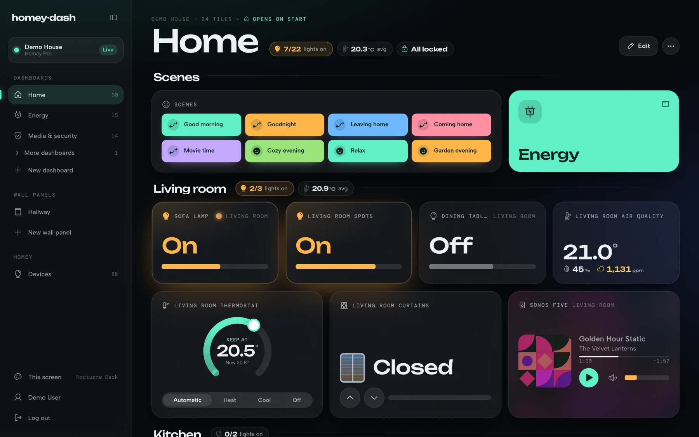

  <a href="https://tiledash.app">
    <picture>
      <source media="(prefers-color-scheme: dark)" srcset="assets/tiledash-logo-on-dark.svg">
      
    </picture>
  </a>

  Live dashboards for your Homey: on your desk, on a wall panel and on e-ink. 
  <a href="https://tiledash.app"><strong>tiledash.app</strong></a>

Tiledash turns your Homey into dashboards built from tiles: lights, thermostats, energy flow, cameras, weather, charts and more. Values come straight from your Homey, so every tile updates the moment something changes.

## What's in this repository

- **Issues.** Found a bug, or missing something? [Open an issue](https://github.com/tiledash/tiledash/issues/new). Please search the existing ones first.
- **Widgets and themes.** Community widgets and themes from the Tiledash store will be published here, so anyone can read their code.

The Tiledash app itself is developed in a separate repository.

## Links

- [tiledash.app](https://tiledash.app): what Tiledash is and what it costs
- [Documentation](https://tiledash.app/docs): getting started, wall panels, themes, and building your own widgets
- [my.tiledash.app](https://my.tiledash.app): log in with your Homey account and start building

---

Tiledash is not affiliated with or endorsed by Athom. Homey is a trademark of Athom B.V.
